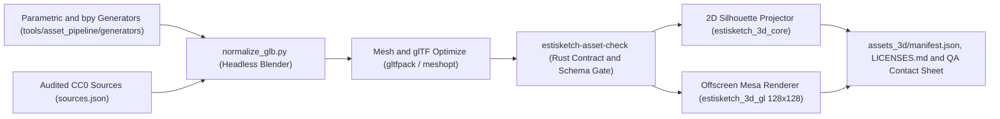
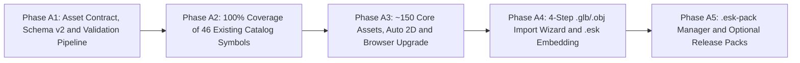

# Comprehensive 3D Model Library & Asset Ecosystem Plan

This document defines the architecture, asset contract, automated build/validation pipeline, unified `manifest.json` v2 schema, ~150-model core catalog blueprint, `.glb`/`.obj` Import Wizard, and `.esk-pack` extension ecosystem for EstiSketch.

> [!NOTE]
> **Sequencing & Prerequisite:** This plan executes **after** Phases 0–4 of [`docs/native_3d_architecture.md`](file:///home/andrew/Documents/Python_Projects/EstiSketch/docs/native_3d_architecture.md) are complete. It directly builds upon `estisketch_3d_core`, `estisketch_3d_gl`, `SceneIR`, `.esk` ZIP project archives, and Rust 2D silhouette projection.

---

## 1. Executive Summary & Prerequisite Relationship

While Phases 0–4 of [`docs/native_3d_architecture.md`](file:///home/andrew/Documents/Python_Projects/EstiSketch/docs/native_3d_architecture.md) establish the native Rust + OpenGL 3.3 viewport, `SceneIR` pipeline, and minimal placeholder/core fixture support, closing the remaining catalog gap with Sweet Home 3D (SH3D) requires turning [`TODO.md`](file:///home/andrew/Documents/Python_Projects/EstiSketch/TODO.md#L6) (*eliminating placeholder/wireframe 3D items*) and [`fixtures_catalog.py`](file:///home/andrew/Documents/Python_Projects/EstiSketch/src/EstiSketch/fixtures_catalog.py) (*46 existing architectural & furniture symbols across 10 categories*) into a cohesive, scalable 2D/3D asset ecosystem.

Trying to hand-sculpt 1,000+ photorealistic models from scratch would create unmaintainable art debt and gigabyte installers. Instead, EstiSketch achieves comprehensive architectural and staging coverage through a **4-tier hybrid pipeline** paired with strict geometric contracts and user extensibility.

### Locked-In Architectural Decisions & Tradeoffs

| Decision Area | Chosen Approach | Rejected Alternatives | Why Chosen Approach Won |
| :--- | :--- | :--- | :--- |
| **Asset Production Strategy** | **4-Tier Hybrid:** Parametric Rust generators + scripted headless Blender (`bpy`) generators + curated/normalized `CC0-1.0` packs + built-in Import Wizard / `.esk-pack` ecosystem | 1. Hand-modeling 1,000+ bespoke assets<br>2. Bundling heavy photorealistic texture packs<br>3. Scraping SH3D `.sh3f` libraries | Parametric Rust guarantees zero distortion on resizable cabinetry/tables; scripted `bpy` yields uniform, MIT/CC0-clean organic plumbing & seating; normalized CC0 + `.esk-pack` covers long-tail decor without bloating git or violating licenses. |
| **Shading & Size Budget** | Texture-free stylized low/mid-poly `.glb` meshes (`200–3,000` tris, `15–80 KB` each) using canonical recolorable PBR slots rendered via `estisketch_3d_gl`'s procedural GLSL + SSAO + crease outlines | Embedded 2K/4K raster diffuse/normal/roughness maps per model | Matches SketchUp/ArchiCAD aesthetic natively, keeps ~150 bundled models under **10 MB** total, and makes every surface seamlessly tintable via the 3D Paint Brush. |
| **2D Symbol Parity** | Retain hand-crafted AIA Cairo renderers in [`render_fixtures.py`](file:///home/andrew/Documents/Python_Projects/EstiSketch/src/EstiSketch/Canvas/render_fixtures.py) for all 46 existing symbols; auto-project crisp top-down 2D outline + crease polylines via `estisketch_3d_core` for expansion & user-imported models | 1. Hand-coding Cairo draw functions for hundreds of new models<br>2. Rendering raw bounding-box rectangles for expansion items | Preserves AIA drafting fidelity for contractor plans while eliminating manual 2D drawing boilerplate for hundreds of new/imported 3D objects. |
| **Long-Tail Extensibility** | Built-in 4-step `.glb`/`.obj` Import Wizard (native Rust `gltf` / `tobj`, zero Blender dependency) + downloadable `.esk-pack` ZIP libraries stored under `get_config_dir()` ([`config.py`](file:///home/andrew/Documents/Python_Projects/EstiSketch/src/EstiSketch/config.py)) | Requiring external Blender installation just to import a downloaded furniture mesh | Gives non-technical users SH3D-style drag-and-drop model expansion while auto-embedding placed assets inside `.esk` project archives for portability. |

---

## 2. Visual Style Guide & Strict 3D Asset Contract

### 2.1 Stylized Architectural Aesthetic
Because `estisketch_3d_gl` renders with directional PCF sun shadows, 16-sample SSAO contact shadows, subtle view-space crease outlines, and procedural GLSL surface shaders, every bundled model must follow one unified silhouette language:
- **Clean Chamfered/Beveled Forms:** Soft outer edges (`2–5 mm` architectural bevels or clean smooth-shaded curves with crease angles) so SSAO and edge-detection shaders catch crisp highlights without noisy micro-facets.
- **No Baked Lighting or Raster Textures:** Core bundled `.glb` files contain **zero** embedded PNG/JPEG textures and zero baked ambient occlusion. Color, roughness, and subtle procedural grain come strictly from canonical material slots.
- **Polygon Budgets:**
  - *Rectilinear & Simple Props:* `100–600` triangles (parametric Rust or simple `bpy`).
  - *Standard Plumbing, Appliances & Seating:* `400–2,000` triangles.
  - *Hero Organic Models (sofas, bathtubs, trees, vehicles):* `1,500–3,000` triangles typical, **`5,000` triangles hard ceiling**.

### 2.2 Geometric & Coordinate Invariants
Every `.glb` loaded into EstiSketch must satisfy the exact coordinate conventions established in [`docs/native_3d_architecture.md`](file:///home/andrew/Documents/Python_Projects/EstiSketch/docs/native_3d_architecture.md) and [`fixtures_catalog.py`](file:///home/andrew/Documents/Python_Projects/EstiSketch/src/EstiSketch/fixtures_catalog.py):
1. **Units:** Real-world **meters** (`1.0` unit = `1.0 m`, matching `INCH_TO_M = 0.0254`).
2. **Disk vs. Runtime Axes:** Stored on disk in standard **glTF 2.0 Y-up** (`+Y` up), rotated into EstiSketch's right-handed **Z-up** world (`+Z` elevation) by `estisketch_3d_core` at load time.
3. **Origin Anchor (`bottom_center`):** Bounding box centered in plan X/Y (`(x_min + x_max)/2 == 0`, `(y_min + y_max)/2 == 0` in Z-up) with the base resting strictly on the floor/support plane (`z_min == 0.0` in Z-up / `y_min == 0.0` in glTF).
4. **Canonical Front-Facing Alignment:** Every model's front face must align identically with [`render_fixtures.py`](file:///home/andrew/Documents/Python_Projects/EstiSketch/src/EstiSketch/Canvas/render_fixtures.py) and `snap_fixture_to_walls` in [`fixtures_catalog.py`](file:///home/andrew/Documents/Python_Projects/EstiSketch/src/EstiSketch/fixtures_catalog.py) so its back edge sits flush against a snapped wall at `rotation = 0°`. *(Phase A1 verifies the exact forward/back sign convention against a golden test fixture in `estisketch_3d_core` before generating the full batch so zero assets face backward.)*
5. **Clean Mesh Topology:** Outward CCW winding normals, applied node transforms (`scale = [1, 1, 1]`, `rotation = [0, 0, 0]`, `translation = [0, 0, 0]`), single merged/clean multi-primitive mesh (no nested armatures, animations, cameras, lights, or empty helper nodes).

### 2.3 Canonical Recolorable Material Slot Table

Standardizing PBR material names across all Rust generators, `bpy` scripts, and normalized CC0 assets allows the 3D Paint Brush (`estisketch_3d_gl`), `Fixture.fill_color`, and `Fixture.countertop_color` ([`components.py`](file:///home/andrew/Documents/Python_Projects/EstiSketch/src/EstiSketch/components.py)) to recolor models predictably:

| Slot Name | Procedural GLSL Style | Default sRGB | Roughness | Metallic | Typical Surfaces |
| :--- | :--- | :--- | :--- | :--- | :--- |
| `Body` | `SOLID` | `#E8E5DF` | `0.55` | `0.00` | Cabinet carcasses, appliance shells, generic painted frames (binds `Fixture.fill_color`) |
| `PrimaryWood` | `WOOD` | `#B88B5A` | `0.48` | `0.00` | Cabinet doors/fronts, dining tables, bed frames, desks |
| `AccentWood` | `WOOD` | `#7A5434` | `0.52` | `0.00` | Trim rails, chair legs, mantel accents, butcher block details |
| `Countertop` | `STONE` | `#EFEFEA` | `0.30` | `0.00` | Vanity/island/cabinet tops (binds `Fixture.countertop_material` & `countertop_color`) |
| `Porcelain` | `SOLID` | `#FAF9F6` | `0.18` | `0.00` | Toilets, bathtubs, sinks, pedestal basins |
| `Stainless` | `SOLID` | `#C7CCD1` | `0.28` | `0.90` | Fridge doors, range tops, kitchen sinks, range hoods, appliance trim |
| `Chrome` | `SOLID` | `#E1E4E8` | `0.12` | `1.00` | Faucets, cabinet pulls, shower hardware, towel bars |
| `MatteBlack` | `SOLID` | `#232528` | `0.45` | `0.20` | Stove grates, oven handles, monitor bezels, modern fixtures |
| `Glass` | `SOLID` (Alpha) | `#D8EAF2` | `0.08` | `0.05` | Shower enclosures, oven windows, glass tabletops, cabinet glass inserts |
| `Upholstery` | `SOLID` | `#7D848B` | `0.85` | `0.00` | Sofa/armchair frames, upholstered headboards, office chair mesh |
| `Cushion` | `SOLID` | `#9CA3AA` | `0.88` | `0.00` | Seat/back cushions, dining chair pads |
| `Bedding` | `SOLID` | `#E6E2D8` | `0.90` | `0.00` | Bed sheets, comforters, duvets |
| `Pillow` | `SOLID` | `#C9CED4` | `0.88` | `0.00` | Bed pillows, throw pillows |
| `Screen` | `SOLID` | `#16181D` | `0.15` | `0.10` | TV panels, computer monitors, microwave/oven displays |
| `Foliage` | `SOLID` | `#4E7A4B` | `0.78` | `0.00` | Houseplants, trees, exterior shrubs |
| `Terracotta` | `STONE` | `#B86B4B` | `0.75` | `0.00` | Planter pots, ceramic vases |
| `Rug` | `SOLID` | `#B5ABA0` | `0.95` | `0.00` | Area rugs, bath mats |

---

## 3. Unified 2D/3D Asset Manifest Schema (`manifest.json` v2)

Extending the initial `manifest.json` sketch from [`docs/native_3d_architecture.md`](file:///home/andrew/Documents/Python_Projects/EstiSketch/docs/native_3d_architecture.md), `src/EstiSketch/assets_3d/manifest.json` serves as the single source of truth for **3D loading, 2D fallback/expansion symbols, browser search metadata, resize constraints, and provenance**.

All 46 keys currently in `FIXTURE_CATALOG` ([`fixtures_catalog.py`](file:///home/andrew/Documents/Python_Projects/EstiSketch/src/EstiSketch/fixtures_catalog.py)) remain intact so existing `.xml` / `.esk` files, `Fixture` properties, and `extract_fixtures_takeoff` ([`building_takeoff.py`](file:///home/andrew/Documents/Python_Projects/EstiSketch/src/EstiSketch/Takeoff/building_takeoff.py)) work with zero breaking changes.

```json
{
  "schema_version": 2,
  "assets": {
    "toilet": {
      "label": "Toilet (Water Closet)",
      "category": "bathroom_fixture",
      "tags": ["wc", "commode", "bath", "plumbing"],
      "short_tag": "WC",
      "generator": "glb",
      "glb": "plumbing/toilet.glb",
      "native_size_m": [0.4572, 0.7112, 0.7366],
      "default_size_in": [18.0, 28.0, 29.0],
      "resizable_axes": ["width", "depth"],
      "aspect_lock": true,
      "mount_surface": "auto",
      "default_elevation_in": 0.0,
      "wall_snap": "back_flush",
      "anchor": "bottom_center",
      "recolor_slots": ["Porcelain", "Chrome"],
      "symbol_2d": {
        "mode": "builtin_cairo",
        "outer": [],
        "creases": []
      },
      "thumbnail": "thumbs/toilet.png",
      "tri_count": 984,
      "license": "CC0-1.0",
      "source": "tools/asset_pipeline/generators/plumbing.py",
      "author": "EstiSketch Project",
      "sha256": "..."
    },
    "sectional_sofa_l": {
      "label": "L-Shaped Sectional Sofa",
      "category": "living_furniture",
      "tags": ["couch", "living", "seating", "sectional"],
      "short_tag": "SECT",
      "generator": "glb",
      "glb": "furniture/sectional_sofa_l.glb",
      "native_size_m": [2.6416, 2.1336, 0.8636],
      "default_size_in": [104.0, 84.0, 34.0],
      "resizable_axes": ["width", "depth", "height"],
      "aspect_lock": false,
      "mount_surface": "auto",
      "default_elevation_in": 0.0,
      "wall_snap": "back_flush",
      "anchor": "bottom_center",
      "recolor_slots": ["Upholstery", "Cushion", "AccentWood"],
      "symbol_2d": {
        "mode": "polylines",
        "outer": [[-0.5, -0.5], [0.5, -0.5], [0.5, 0.5], [0.08, 0.5], [0.08, -0.05], [-0.5, -0.05]],
        "creases": [[[-0.5, -0.35], [0.5, -0.35]], [[0.35, -0.35], [0.35, 0.5]]]
      },
      "thumbnail": "thumbs/sectional_sofa_l.png",
      "tri_count": 1420,
      "license": "CC0-1.0",
      "source": "tools/asset_pipeline/generators/living_furniture.py",
      "author": "EstiSketch Project",
      "sha256": "..."
    }
  }
}
```

Key schema fields:
- **`generator` (`"parametric_rust"` | `"glb"`):** Parametric Rust entries generate non-warping meshes directly in `estisketch_3d_core` with `"glb": null` and `tri_count: 0`.
- **`resizable_axes` & `aspect_lock`:** Prevents users or properties editors from squashing curved organic items (e.g., locking `width`/`depth` aspect on a toilet or spiral chair) while allowing free scaling on tables, rugs, and cabinets.
- **`symbol_2d`:** Uses `"builtin_cairo"` for the 46 existing symbols in [`render_fixtures.py`](file:///home/andrew/Documents/Python_Projects/EstiSketch/src/EstiSketch/Canvas/render_fixtures.py), and `"polylines"` (normalized to `[-0.5, 0.5]` unit square so resizing in 2D scales cleanly) for all expansion and user-imported assets.

---

## 4. Complete Core Catalog Blueprint (~150 Bundled Assets, `< 10 MB`)

### Tier 1 — Parametric Rust Generators (Zero `.glb` Disk Footprint)
Handled natively by `estisketch_3d_core` so stiles, rails, legs, tabletop thicknesses, and glass panels maintain exact physical proportions at any user dimension:
- **Existing Cabinetry & Vanities (10):** `base_cabinet`, `base_drawer_cabinet`, `sink_base_cabinet`, `corner_base_cabinet`, `upper_cabinet`, `corner_upper_cabinet`, `tall_pantry`, `island_cabinet`, `vanity_single`, `vanity_double` (including automatic continuous countertop & backsplash run merging).
- **Existing Enclosures & Rectilinear Furniture (10):** `shower_square`, `shower_corner`, `coffee_table`, `end_table`, `dining_table`, `desk`, `bookshelf`, `nightstand`, `dresser`, `tv_console`.
- **New Parametric Expansion Items (~18):** `floating_vanity`, `linen_tower`, `upper_glass_cabinet`, `island_waterfall`, `dining_table_round`, `dining_table_oval`, `desk_l_shaped`, `console_table`, `media_credenza`, `wall_tv_flat`, `fireplace_mantel`, `area_rug_rect`, `area_rug_round`, `closet_rod_shelf`, `garage_storage_rack`, `workbench`, `pool_table`, `conference_table`.

### Tier 2 — Scripted Headless Blender (`bpy`) Generators
Reproducible Python generators in `tools/asset_pipeline/generators/` invoked via `blender --background --python` so curved plumbing, appliances, seating, and lighting share consistent bevels, edge loops, and material slots:
- **Remaining Existing Fixtures & Appliances (17):** `toilet`, `bathtub`, `pedestal_sink`, `kitchen_sink_single`, `kitchen_sink_double`, `utility_sink`, `refrigerator`, `range_stove`, `cooktop`, `wall_oven`, `dishwasher`, `range_hood`, `microwave`, `washer`, `dryer`, `water_heater`, `furnace`, `air_conditioner` *(18 symbols total including `water_heater`/`furnace`/`air_conditioner`)*.
- **Remaining Existing Furniture (8):** `sofa`, `loveseat`, `armchair`, `bed_king`, `bed_queen`, `bed_twin`, `dining_chair`, `office_chair`.
- **New Scripted Plumbing, Kitchen & Utility Variants (~20):** `toilet_wall_hung`, `bidet`, `urinal`, `bathtub_freestanding`, `bathtub_corner_soaking`, `vessel_sink`, `farmhouse_apron_sink`, `refrigerator_french_door`, `refrigerator_wine_cooler`, `range_48_pro`, `double_wall_oven`, `range_hood_chimney`, `range_hood_island`, `washer_dryer_stacked`, `tankless_water_heater`, `electrical_panel`, `mini_split_indoor`, `mini_split_outdoor`, `chest_freezer`, `garbage_disposal_switch` *(or `trash_compactor`)*.
- **New Scripted Living, Bedroom, Dining & Lighting (~32):** `sectional_sofa_l`, `sectional_sofa_u`, `sofa_sleeper`, `chaise_lounge`, `ottoman`, `accent_stool`, `bar_stool`, `counter_stool`, `dining_bench`, `bed_full`, `bed_california_king`, `bed_bunk`, `baby_crib`, `wardrobe_armoire`, `vanity_makeup_table`, `gaming_chair`, `filing_cabinet`, `printer_stand`, `ceiling_fan`, `ceiling_flush_light`, `pendant_light`, `chandelier_linear`, `chandelier_round`, `table_lamp`, `floor_lamp`, `wall_sconce`, `recessed_can_light`, `smoke_detector`, `thermostat_wall`, `towel_warmer`, `coat_rack`, `bench_entryway`.

### Tier 3 — Curated & Normalized `CC0-1.0` Expansion Models
Organic interior decor and exterior/site context models sourced strictly from audited `CC0-1.0` packs (**Kenney Furniture Kit**, **Quaternius Ultimate/Interior Packs**, and decimated **Poly Haven CC0**), passed through `normalize_glb.py`:
- **Interior Organic Decor & Recreation (~12):** `potted_plant_small`, `potted_plant_tall`, `monstera_planter`, `piano_upright`, `piano_baby_grand`, `treadmill`, `exercise_bike`, `dog_bed`, `wall_mirror_round`, `wall_art_framed`, `curtain_drape_pair`, `interior_column_round`.
- **Garage, Exterior & Site Context (~14):** `car_sedan`, `car_suv`, `pickup_truck` *(critical for verifying garage bay clearances)*, `patio_table_umbrella`, `patio_lounge_chair`, `patio_sofa`, `bbq_grill`, `fire_pit`, `hot_tub`, `tree_deciduous`, `tree_evergreen`, `shrub_round`, `mailbox_post`, `trash_bin_outdoor`.

### Catalog Size & Polygon Budget Summary

| Category Group | Parametric Rust | Scripted `bpy` | Normalized `CC0` | Total Items | Avg Tris / `.glb` | Disk Budget (`.glb` + PNG) |
| :--- | :---: | :---: | :---: | :---: | :---: | :---: |
| Kitchen Cabinets & Bath Vanities | 13 | 0 | 0 | **13** | 0 (Rust) | `0.0 MB` |
| Bath & Plumbing Fixtures | 2 | 12 | 0 | **14** | ~1,100 | `~0.9 MB` |
| Kitchen, Laundry & Mechanical | 0 | 24 | 0 | **24** | ~950 | `~1.3 MB` |
| Living, Dining, Bedroom & Office | 23 | 22 | 8 | **53** | ~1,150 | `~2.4 MB` |
| Lighting, Rugs, Fireplaces & Decor | 4 | 10 | 4 | **18** | ~800 | `~0.8 MB` |
| Garage Vehicles, Patio & Landscaping | 2 | 0 | 14 | **16** | ~2,100 | `~2.2 MB` |
| **Total Core Bundled Catalog** | **44** | **68** | **26** | **138–150** | **~1,150** | **`< 8.0 MB` (Ceiling `10 MB`)** |

---

## 5. Automated Asset Build, Normalization & Validation Pipeline (`tools/asset_pipeline/`)

Manual modeling and ad-hoc exports inevitably produce mismatched scales, floating origins, and broken materials. All core assets are generated or normalized deterministically through a single reproducible pipeline:



### Repository Layout Separation
- **Dev-Only Pipeline (`tools/asset_pipeline/` — excluded from runtime installers):**
  - `build_all.py`: Orchestrates generators, normalization, validation, thumbnails, and manifest regeneration.
  - `sources.json`: Pinned URLs, versions, and SHA-256 checksums for external `CC0-1.0` raw archives (heavy raw source ZIPs are **not** committed to git).
  - `generators/`: Shared `bpy` helper modules (`common_mesh.py`, `common_materials.py`, `export_utils.py`) plus category scripts (`plumbing.py`, `appliances.py`, `living_furniture.py`, `bedroom_furniture.py`, `lighting.py`).
  - `normalize_glb.py`: Headless Blender script enforcing the §2 asset contract.
  - `validate_assets.py` + `render_qa_sheet.py`: CI checks and visual HTML/PNG contact-sheet builder.
- **Shipped Runtime Payload (`src/EstiSketch/assets_3d/`):**
  - `manifest.json` (v2 unified catalog)
  - `LICENSES.md` (auto-generated provenance & license ledger)
  - `models/<category>/<id>.glb`
  - `thumbs/<id>.png` (`128×128` transparent-background 3/4 isometric renders)

### Pipeline Stage Details
1. **`normalize_glb.py` (Headless Blender):**
   - Imports generated or raw `CC0` source mesh, removes cameras/lights/empties/armatures/raster images, applies all transforms, recalculates outward normals, snaps bounding box center to `(0, 0)` and base to `y_min = 0` (glTF Y-up), rotates to canonical front orientation, scales cleanly to target `native_size_m`, runs planar/collapse decimation if `tri_count > budget`, remaps materials to §2.3 canonical slot names, and exports binary `.glb`.
2. **Mesh Optimization:**
   - Passes `.glb` through `gltfpack` / mesh optimizer (vertex cache + quantization safe for architectural edges) without lossy silhouette warping.
3. **CI Contract Gate (`cargo test` + `validate_assets.py`):**
   - Validates every entry in `manifest.json` against strict invariants:
     - Valid glTF 2.0 binary schema (`gltf` crate parse succeeds).
     - `bbox_size_m` matches `native_size_m` within `<= 0.01 m`.
     - Anchor verified (`|center_x| <= 0.005 m`, `|center_y| <= 0.005 m`, `|z_min| <= 0.002 m`).
     - Triangle count within category ceiling (`<= 5,000` absolute max).
     - All material names exist in §2.3 canonical slots (or explicit asset override list); zero embedded textures in core pack.
     - `license` is strictly `"CC0-1.0"` or `"MIT"` and entry exists in `LICENSES.md`.
     - `symbol_2d.polylines` is non-empty and bounded within `[-0.5, 0.5]` whenever `mode == "polylines"`.
4. **1:1 Offscreen Thumbnails (`estisketch_3d_gl` via Mesa/EGL):**
   - Renders each asset at a consistent 3/4 isometric camera angle with warm sun + SSAO + crease outlines into `128×128` PNGs so catalog previews match the live 3D viewport 1:1, plus generates a single visual QA contact sheet PNG/HTML for human spot-checking.

---

## 6. 2D/3D Unified Catalog, Renderer & Browser Integration

### 6.1 Unified Catalog Loading (`fixtures_catalog.py`)
Refactor [`fixtures_catalog.py`](file:///home/andrew/Documents/Python_Projects/EstiSketch/src/EstiSketch/fixtures_catalog.py) to load bundled `assets_3d/manifest.json` on startup, merge enabled `.esk-pack` manifests and user-imported assets from `get_config_dir()` ([`config.py`](file:///home/andrew/Documents/Python_Projects/EstiSketch/src/EstiSketch/config.py)), and preserve `FIXTURE_CATALOG` / `get_fixture_spec()` compatibility for all callers.
- **Takeoff Isolation:** `FURNITURE_CATEGORIES` in [`fixtures_catalog.py`](file:///home/andrew/Documents/Python_Projects/EstiSketch/src/EstiSketch/fixtures_catalog.py) (expanded to include lighting, decor, vehicles, and landscaping) ensures decorative/staging items never pollute structural framing, plumbing, or cabinetry counts in `extract_fixtures_takeoff` ([`building_takeoff.py`](file:///home/andrew/Documents/Python_Projects/EstiSketch/src/EstiSketch/Takeoff/building_takeoff.py)).

### 6.2 2D Symbol Rendering (`Canvas/render_fixtures.py`)
Extend [`render_fixtures.py`](file:///home/andrew/Documents/Python_Projects/EstiSketch/src/EstiSketch/Canvas/render_fixtures.py) with a clean dual-mode dispatcher:
- `mode == "builtin_cairo"` → runs existing hand-crafted AIA architectural symbol painters.
- `mode == "polylines"` → draws the manifest's `symbol_2d.outer` polygon (opaque fill masking underlying floor patterns, honoring `fill_color` and `opacity`) followed by `symbol_2d.creases` strokes scaled to `(fixture.width, fixture.depth)` and respecting `printing=True` and `LineWeights` ([`print_settings.py`](file:///home/andrew/Documents/Python_Projects/EstiSketch/src/EstiSketch/Printing/print_settings.py)).

### 6.3 Upgraded `FixtureBrowserDialog` (`Dialogs/fixture_browser.py`)
Upgrade [`fixture_browser.py`](file:///home/andrew/Documents/Python_Projects/EstiSketch/src/EstiSketch/Dialogs/fixture_browser.py) to comfortably navigate 150–1,000+ assets:
- **View Switcher:** `List View` | `Grid View` (`Gtk.FlowBox`) + `2D Symbol` | `3D Preview` thumbnail toggle.
- **Smart Filtering:** Search by label, tags, or approximate dimensions; category sidebar/dropdown; source filter (*All*, *Built-in*, *Packs*, *User Imports*).
- **Favorites & Recents:** Star button on any item and a *Recently Used* strip persisted in `settings.json` via [`config.py`](file:///home/andrew/Documents/Python_Projects/EstiSketch/src/EstiSketch/config.py).
- **Resize & Clearance Guards:** `PropertiesDock` ([`properties_dock.py`](file:///home/andrew/Documents/Python_Projects/EstiSketch/src/EstiSketch/Dialogs/properties_dock.py)) honors `resizable_axes` and `aspect_lock` per asset, while [`design_checks.py`](file:///home/andrew/Documents/Python_Projects/EstiSketch/src/EstiSketch/geometry/design_checks.py) continues enforcing clearances on resized or newly added fixtures.

---

## 7. User 3D Model Import Wizard & `.esk-pack` Extensible Libraries

Rather than shipping 1,500 decorative models in the base installer, EstiSketch matches SH3D's long-tail workflow through two built-in extension mechanisms:

### 7.1 Built-In 4-Step `.glb` / `.obj` Import Wizard (`Dialogs/asset_import_wizard.py`)
Powered natively by `estisketch_3d_core` (`gltf` + `tobj` Rust crates) so users **do not need Blender installed**:
1. **Step 1 — Select File & Mesh Inspection:** User selects `.glb`, `.gltf`, or `.obj` (+ optional `.mtl`). Rust parses vertex/triangle counts and bounds; if `tri_count > 25,000`, the wizard offers one-click automatic mesh simplification before import.
2. **Step 2 — Orient & Scale:** Interactive 3D preview (`Gtk.GLArea`) with 90° X/Y/Z rotation buttons and a floor arrow showing the canonical front/wall-snap direction, exact `Width × Depth × Height` inputs in EstiSketch's active display units, `Aspect Lock` toggle, and automatic `bottom_center` grounding.
3. **Step 3 — 2D Plan Symbol & Material Slots:** Runs Rust top-down 2D silhouette + crease projection live with a detail/simplification slider and lets the user map imported material names to §2.3 canonical slots (so the 3D Paint Brush works on imported furniture).
4. **Step 4 — Catalog Metadata & Save:** Enter label, category, tags, and `mount_surface` (`auto`, `floor`, `wall`, `countertop`). Saves normalized `.glb`, thumbnail PNG, and entry into `get_config_dir()/assets_3d/user/<asset_id>/`.

### 7.2 Automatic `.esk` Project Embedding
When a project using a User or `.esk-pack` asset is saved via [`project_io.py`](file:///home/andrew/Documents/Python_Projects/EstiSketch/src/EstiSketch/project_io.py), EstiSketch copies the referenced `.glb` and cached `symbol_2d` polylines into `assets/custom_<sha256_prefix>.glb` inside the `.esk` ZIP archive (deduplicating identical hashes). Any recipient opening the `.esk` file sees the complete 2D symbol and 3D mesh without needing the creator's local packs installed.

### 7.3 `.esk-pack` Downloadable Asset Packs
A `.esk-pack` file is a standard ZIP archive analogous to SH3D's `.sh3f` libraries:

```text
modern_living_v1.esk-pack (ZIP)
├── pack.json         # { "id": "modern_living", "name": "Modern Living Pack", "version": "1.0.0", "author": "...", "min_estisketch_version": "0.5.0" }
├── manifest.json     # Schema v2 entries (same structure as core manifest)
├── LICENSES.md       # Required per-asset attribution & license ledger
├── models/           # Normalized .glb meshes
└── thumbs/           # 128x128 PNG thumbnails
```

- **Install Location:** `get_config_dir()/assets_3d/packs/<pack_id>/`.
- **Pack Manager UI (*Library → Manage Asset Packs…*):** Import local `.esk-pack` files, toggle packs on/off, uninstall packs, and optionally fetch curated CC0 packs published on GitHub Releases (e.g., *Landscaping & Terrain Decor Pack*, *Commercial & Office Pack*, *Traditional & Craftsman Decor Pack*).

---

## 8. Licensing, Provenance & Packaging Hygiene

### Strict License Policy

| Source Category | Allowed Licenses | Prohibited Licenses | Policy Rule |
| :--- | :--- | :--- | :--- |
| Parametric Rust & In-Repo `bpy` Scripts | `MIT`, `CC0-1.0` | `GPL`, `LGPL`, `AGPL` | Authored clean-room for EstiSketch; zero copied HB5 scripts or `.blend` files. |
| Bundled Third-Party Core Models | `CC0-1.0` only | `CC-BY` (if attribution burden is unclear), `CC-BY-NC`, `CC-BY-SA`, `GPL`, `LAL`, Sketchfab Standard | Keeps the MIT-licensed base application completely friction-free for commercial contractors and downstream distro packagers. |
| Optional Downloadable `.esk-pack`s | `CC0-1.0`, `CC-BY-4.0` (with mandatory `LICENSES.md`) | `NC`, `ND`, `GPL`, unverified scrapes | Never blindly batch-import SH3D `.sh3f` packs; each pack item requires audited provenance. |

### Repo & Installer Packaging Alignment
- **Git Repo Footprint:** Store compact normalized `.glb` and `128×128` PNG thumbnails (`< 10 MB` total) under `src/EstiSketch/assets_3d/`. Keep multi-hundred-megabyte raw source packs out of git, tracked instead via `tools/asset_pipeline/sources.json`.
- **Installer Integration:** Aligns directly with the packaging updates defined in [`docs/native_3d_architecture.md`](file:///home/andrew/Documents/Python_Projects/EstiSketch/docs/native_3d_architecture.md) §9.2 for [`build_deb.py`](file:///home/andrew/Documents/Python_Projects/EstiSketch/packaging/build_deb.py), [`estisketch.spec`](file:///home/andrew/Documents/Python_Projects/EstiSketch/packaging/estisketch.spec), and [`conda-recipe/meta.yaml`](file:///home/andrew/Documents/Python_Projects/EstiSketch/conda-recipe/meta.yaml), all of which package `src/EstiSketch/assets_3d/` as data without shipping `tools/asset_pipeline/`.

---

## 9. Phased Implementation Roadmap (Post-3D-Engine: Phases A1–A5)



### Phase A1: Asset Contract, `manifest.json` v2 & Automated Pipeline
- **Scope:** Finalize the canonical front-axis orientation against a golden test fixture in `estisketch_3d_core`; implement `manifest.json` v2 loader; build `tools/asset_pipeline/` (`normalize_glb.py`, `validate_assets.py`, Rust `estisketch-asset-check`, Mesa `128×128` thumbnailer, and contact-sheet generator); wire validation into CI.
- **Exit Criteria:** A test `.glb` passes normalization, bounds/anchor/slot validation, 2D silhouette extraction, and offscreen thumbnail rendering automatically in CI.

### Phase A2: 100% Coverage of All 46 Existing `FIXTURE_CATALOG` Symbols
- **Scope:** Implement parametric Rust generators for all 20 cabinetry/vanity/shower/rectilinear symbols; write headless `bpy` generator scripts in `tools/asset_pipeline/generators/` for the remaining 26 plumbing, appliance, HVAC, sofa, chair, and bed symbols.
- **Exit Criteria:** Zero wireframe or fallback boxes remain for any item in [`fixtures_catalog.py`](file:///home/andrew/Documents/Python_Projects/EstiSketch/src/EstiSketch/fixtures_catalog.py); all 3 demo houses render with complete 3D fixtures and pass `pytest` + `cargo test` contract checks.

### Phase A3: Core Expansion (~150 Bundled Assets), Auto 2D & Browser Upgrade
- **Scope:** Expand parametric & `bpy` generators plus audited/normalized `CC0-1.0` models to reach ~138–150 total core models (`< 10 MB`); implement `"polylines"` 2D rendering in [`render_fixtures.py`](file:///home/andrew/Documents/Python_Projects/EstiSketch/src/EstiSketch/Canvas/render_fixtures.py); upgrade [`fixture_browser.py`](file:///home/andrew/Documents/Python_Projects/EstiSketch/src/EstiSketch/Dialogs/fixture_browser.py) with grid/2D/3D previews, tags, Favorites, and Recents; enforce `resizable_axes`/`aspect_lock` in [`properties_dock.py`](file:///home/andrew/Documents/Python_Projects/EstiSketch/src/EstiSketch/Dialogs/properties_dock.py).
- **Exit Criteria:** Every expansion asset displays both a crisp 2D plan symbol (screen & PDF/SVG print) and a 3D mesh, passes license/size CI checks (`< 10 MB`), and isolates non-building decor from material takeoffs.

### Phase A4: Built-In `.glb`/`.obj` Import Wizard & `.esk` Portability
- **Scope:** Add Rust `.obj`/`.mtl` + `.glb` importer & optional mesh decimator in `estisketch_3d_core`; build the 4-step `Dialogs/asset_import_wizard.py` UI; store user assets under `get_config_dir()/assets_3d/user/`; extend [`project_io.py`](file:///home/andrew/Documents/Python_Projects/EstiSketch/src/EstiSketch/project_io.py) to embed used custom/pack `.glb` files and cached 2D silhouettes into `.esk` archives.
- **Exit Criteria:** A user without Blender installed can import a third-party `.obj`/`.glb`, orient/scale it, preview its auto-projected 2D plan symbol, place it on the canvas, save `.esk`, and reopen identically on a clean profile.

### Phase A5: `.esk-pack` Pack Manager & Optional Release Packs
- **Scope:** Implement `.esk-pack` ZIP validation/installation under `get_config_dir()/assets_3d/packs/`; add the *Manage Asset Packs…* dialog; publish initial optional packs (*Landscaping & Exterior*, *Commercial & Office*, *Traditional Decor*) to GitHub Releases.
- **Exit Criteria:** Users can install, toggle, search, and remove `.esk-pack` libraries cleanly without bloating the core EstiSketch `.deb`, `AppImage`, or Windows `.exe` installers.
