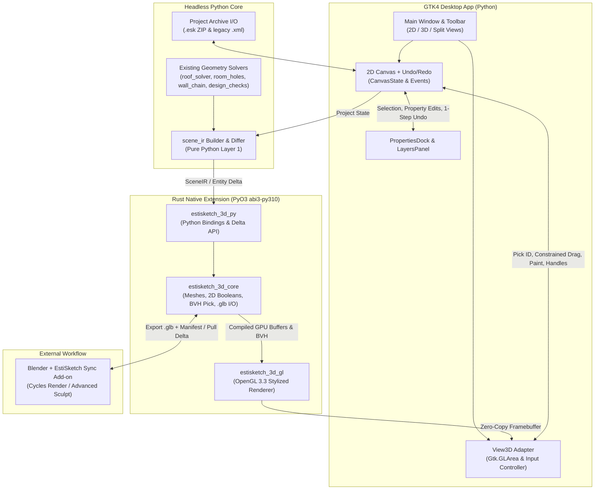
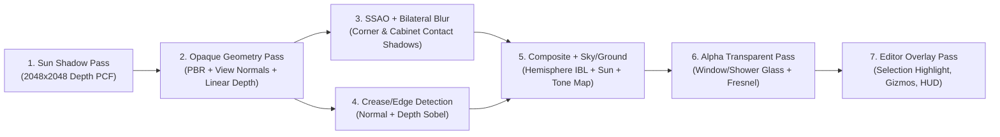
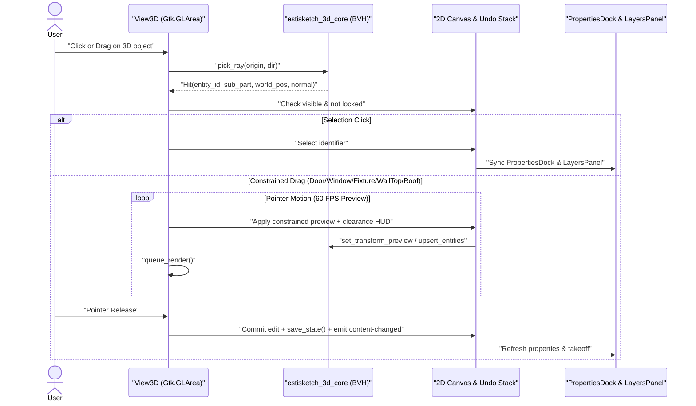
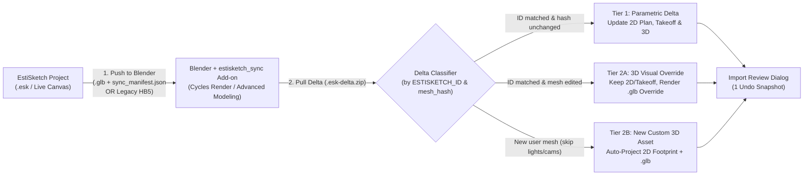
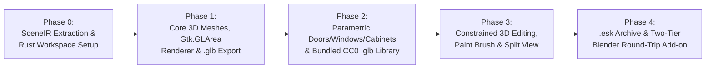

# Native Rust 3D Engine & Bidirectional Blender Sync Architecture

This document defines the architecture, rendering pipeline, clean-room parametric modeling system, 3D editing UX, `.esk` archive format, two-tier Blender round-trip protocol, and packaging strategy for EstiSketch's built-in 3D engine.

---

## 1. Executive Summary & Architectural Decisions

EstiSketch currently relies on launching an external Blender 5.1+ process with the GPL-3.0 **Home Builder 5 (HB5)** extension via [`estisketch_to_hb5.py`](file:///home/andrew/Documents/Python_Projects/EstiSketch/src/EstiSketch/blender_bridge/estisketch_to_hb5.py) and [`launcher.py`](file:///home/andrew/Documents/Python_Projects/EstiSketch/src/EstiSketch/blender_bridge/launcher.py). While effective as an external bridge, that model creates friction for distribution, licensing, and round-trip editing (as tracked in [`TODO.md`](file:///home/andrew/Documents/Python_Projects/EstiSketch/TODO.md#L6-L9)):

1. **Distribution & Licensing:** EstiSketch is MIT-licensed ([`pyproject.toml`](file:///home/andrew/Documents/Python_Projects/EstiSketch/pyproject.toml)), whereas Blender and HB5 are GPL-3.0. Bundling Blender (~500 MB+) or copying HB5 Python modules is unacceptable.
2. **User Experience:** Users want instant `2D | 3D | Split` visualization and intuitive architectural edits inside EstiSketch without learning Blender's 6-DOF viewport just to slide a window, adjust wall height, or change siding.
3. **Pro Escape Hatch:** Users who *do* want Cycles photorealism or bespoke mesh sculpting still need a clean push-to-Blender and pull-back workflow without corrupting EstiSketch's parametric 2D plan and material takeoff.

### Locked-In Architectural Decisions & Tradeoffs

| Decision Area | Chosen Approach | Rejected Alternatives | Why Chosen Approach Won |
| :--- | :--- | :--- | :--- |
| **Viewport & GPU Backend** | Embedded `Gtk.GLArea` + Rust OpenGL 3.3 Core (`glow`) via PyO3 (`abi3-py310`) | 1. `Gtk.Picture` + `wgpu` offscreen readback<br>2. Separate native `winit` + `wgpu` companion window over IPC | True zero-copy `2D \| 3D \| Split` inside the existing GTK4 window on Linux (Wayland/X11) and Windows. Shares `PropertiesDock`, `LayersPanel`, and Undo/Redo directly. Avoids `wgpu` DMA-BUF/DXGI surface interop fragility while OpenGL 3.3 easily handles stylized PBR, shadows, SSAO, and edge outlines. |
| **3D Geometry Split** | Phased: Shared Python `SceneIR` first -> Rust mesh builder, renderer, picking & `.glb` export | Immediate full Rust rewrite of roof, miter, and room-hole solvers | EstiSketch's pure-Python Layer 1 solvers ([`roof_solver.py`](file:///home/andrew/Documents/Python_Projects/EstiSketch/src/EstiSketch/geometry/roof_solver.py), [`room_holes.py`](file:///home/andrew/Documents/Python_Projects/EstiSketch/src/EstiSketch/geometry/room_holes.py), [`wall_chain.py`](file:///home/andrew/Documents/Python_Projects/EstiSketch/src/EstiSketch/geometry/wall_chain.py)) are already tested and drive 2D & takeoff. Feeding a neutral `SceneIR` to Rust guarantees 0% divergence between 2D, takeoff, and 3D while letting heavy solvers migrate to Rust later if needed. |
| **3D Asset Strategy** | Hybrid: Parametric Rust generators for sized architecture & cabinetry + bundled stylized `CC0-1.0` `.glb` library for organic fixtures/furniture | 100% procedural Rust box/cylinder geometry for everything | Architecture, openings, stairs, and cabinets need exact parametric scaling without distortion. Organic items (sofas, toilets, beds, ranges) look dramatically better as clean low-poly `.glb` meshes while sharing the same `.glb` pipeline used for custom Blender round-trips. |
| **Project File & Blender Sync** | `.esk` ZIP archive (backwards-compatible with `.xml`) + two-tier Blender sync add-on | Standalone `.xml` + external sidecar asset folder | Single-file portability for embedded blueprints and custom `.glb` assets, prevents broken asset links when sharing files, eliminates base64 XML bloat for blueprints, and keeps `project.xml` intact inside the ZIP. |
| **Core 3D Editing Scope** | Click-to-select, constrained wall/floor dragging + rotation, 3D Paint/Material Brush, direct wall height & roof pitch handles | Full 3D authoring (placing brand-new walls/doors/fixtures in 3D) in Phase 1 | Covers 90% of visual review and iteration tasks safely with architectural constraints, while deferring full 3D object placement to post-core phases to keep UX simple and bug-free. |

---

## 2. Clean-Room Concepts Borrowed from Home Builder 5

### Clean-Room & Licensing Policy

> [!IMPORTANT]
> **Strict Clean-Room Rule:** Blender and Home Builder 5 are licensed under `GPL-3.0-or-later`. EstiSketch is licensed under `MIT`. Developers and contributors MUST NOT copy, port, or derive code, `.blend` node trees, or bundled `.blend`/image assets from Home Builder 5 into EstiSketch. All architectural behaviors described below are industry-standard CAD/BIM concepts implemented from first principles in Rust and Python.

### Essential Concepts Adapted (Clean-Room)

| Concept | Clean-Room Design in EstiSketch | User Value |
| :--- | :--- | :--- |
| **Parametric Bounding Envelope ("Cage") + Semantic Options** | Doors, windows, and cabinets are specified by `(width, depth, height)` plus semantic parameters (style, lite grid, drawer count, swing) and regenerated piecewise so stiles, rails, frames, and mullions keep fixed physical thickness instead of stretching. | Resizing a `30"` cabinet to `36"` or a `36"` door to `32"` never warps frame profiles or hardware proportions. |
| **Separated Rough-Opening Cutters vs. Trim/Hardware Assemblies** | Wall cutout intervals (`OpeningCutIR`) are evaluated independently of the door/window frame, casing, sill, glass, and swing indicator meshes. | Allows collinear split-wall openings, mixed-thickness wall intersections, and corner trims without boolean glitches. |
| **Wall-Aware Runs & Continuous Elements** | Adjacent base cabinets aligned within tolerance automatically merge into continuous countertops and shared backsplashes, expose finished end-panels only on un-abutted ends, and wall runs generate mitered baseboards/crown molding around door cutouts. | Kitchens and room trim look cohesive out of the box without manual alignment of dozens of counter slabs. |
| **Constrained 3D Placement + Live Clearance HUD** | Dragging an opening slides strictly along its host wall chain; dragging a fixture slides strictly on its floor/elevation plane with wall-clamping. Live viewport overlays display left/right clearance distances to nearest corners/adjacent objects. | Eliminates Blender's accidental "floating in midair" errors; users place items accurately at a glance. |
| **Unified Surface & Finish Palette** | Named material presets (`Drywall`, `Hardie Lap Siding`, `Brick`, `Oak Plank`, `Quartz`, etc.) keyed by slug + RGB tint, assignable face-by-face or room-wide. | Enables the 3D Paint Brush and consistent visual/takeoff material naming across 2D, 3D, and Blender. |
| **Room / Level Quick Navigator & Dollhouse View** | One-click camera framing per room or building level, plus automatic roof/upper-floor hiding ("Dollhouse mode"). | Effortless inspection of multi-story interiors without manually toggling dozens of visibility checkboxes. |

### Explicitly Excluded HB5 Scope (Non-Goals)

To keep EstiSketch approachable and maintainable, the native 3D engine explicitly **excludes**:
- **CNC / Shop Fabrication Internals:** Dadoes, rabbet joinery, dowel/hinge boring patterns, drawer-box part lists, and 5-piece router profiles.
- **Closet & Millwork Sub-Systems:** Parametric closet rod/cubby generators, custom molding profile extruders, and appliance spec-sheet collision builders.
- **General 3D Modeling / VFX:** Arbitrary vertex/mesh editing, modifiers, sculpting, UV unwrapping, or node-graph shader authoring (that belongs in Blender via Push/Pull).

---

## 3. System Architecture & Repository Layout



### Proposed Repository Layout

Existing files remain untouched in their current modules; new components integrate cleanly alongside them:

```text
EstiSketch/
├── rust/
│   ├── Cargo.toml                         # Workspace root
│   └── crates/
│       ├── estisketch_3d_core/            # Headless Rust: SceneIR -> Meshes, 2D booleans, BVH, .glb
│       ├── estisketch_3d_gl/              # OpenGL 3.3 Core (glow) renderer, SSAO, shadows, outlines
│       └── estisketch_3d_py/              # PyO3 abi3-py310 module (_native_3d)
├── src/EstiSketch/
│   ├── scene_ir/                          # NEW: Extracted pure-Python Layer 1 IR builder + delta differ
│   ├── View3D/                            # NEW: Gtk.GLArea wrapper, 3D toolbar, camera & edit controllers
│   ├── assets_3d/                         # NEW: Bundled CC0 .glb library, manifest.json, LICENSES.md
│   ├── blender_bridge/
│   │   ├── estisketch_to_hb5.py           # Refactored to consume scene_ir (legacy HB5 option)
│   │   ├── launcher.py                    # Extended for glTF + sync manifest push & legacy HB5
│   │   └── sync_addon/                    # NEW: Lightweight MIT Blender add-on (estisketch_sync)
│   ├── project_io.py                      # Extended for .esk ZIP container + legacy .xml fallback
│   └── main.py                            # 2D | 3D | Split view switcher & View3D wiring
└── docs/
    └── native_3d_architecture.md          # This document
```

### Coordinate System & Units Invariant

To guarantee exact alignment between 2D plans, native 3D, `.glb` exports, and Blender round-trips:
- **2D Model Units:** Inches (`float`), screen/canvas Y-down (`+X` right, `+Y` down), as defined in [`AGENTS.md`](file:///home/andrew/Documents/Python_Projects/EstiSketch/AGENTS.md) and [`components.py`](file:///home/andrew/Documents/Python_Projects/EstiSketch/src/EstiSketch/components.py).
- **3D World Units:** Meters (`INCH_TO_M = 0.0254`), right-handed **Z-up** (`+X` east/right, `+Y` north/up-on-plan, `+Z` elevation), centered on the 2D plan bounding-box center `(cx, cy)` using the exact transform already established in [`estisketch_to_hb5.py`](file:///home/andrew/Documents/Python_Projects/EstiSketch/src/EstiSketch/blender_bridge/estisketch_to_hb5.py):
  $$x_{3D} = (x_{2D} - c_x) \cdot 0.0254, \qquad y_{3D} = -(y_{2D} - c_y) \cdot 0.0254, \qquad z_{3D} = z_{in} \cdot 0.0254$$
- **OpenGL Clip Mapping:** `estisketch_3d_gl` renders directly in Z-up world meters using a view-projection matrix whose camera `up` defaults to `(0, 0, 1)`, avoiding fragile Y-up/Z-up conversions at the glTF/Blender boundary (the glTF exporter applies the single standard glTF Y-up rotation at export/import time).

---

## 4. Shared Scene IR & Incremental Sync Protocol

### Extracting Layer 1 into `src/EstiSketch/scene_ir/`

Currently, [`estisketch_to_hb5.py`](file:///home/andrew/Documents/Python_Projects/EstiSketch/src/EstiSketch/blender_bridge/estisketch_to_hb5.py) contains ~2,400 lines of pure-Python, `bpy`-free geometry preparation (Layer 1). Refactoring Layer 1 into `src/EstiSketch/scene_ir/` lets **both** the native Rust 3D engine and the Blender bridge consume identical solved data directly from the live canvas (without round-tripping through XML on every frame).

### Versioned `SceneIR` Schema (`schema_version = 1`)

Serialized across the Python/Rust PyO3 boundary as flat typed structs (or MessagePack/JSON for headless tests & IPC):

```json
{
  "schema_version": 1,
  "plan_center_in": [420.0, 310.0],
  "sun": { "north_angle_deg": 0.0, "azimuth_deg": 145.0, "elevation_deg": 48.0 },
  "levels": [
    { "id": "lvl_1", "name": "Level 1", "elevation_m": 0.0, "height_m": 2.4384, "floor_thickness_m": 0.254 }
  ],
  "walls": [
    {
      "id": "wall-abc123",
      "level_id": "lvl_1",
      "layer_id": "layer_default",
      "visible": true,
      "locked": false,
      "segments": [
        {
          "seg_index": 0,
          "start_m": [-5.0, -3.0],
          "end_m": [5.0, -3.0],
          "thickness_m": 0.1524,
          "height_start_m": 2.4384,
          "height_end_m": 2.4384,
          "left_angle_rad": 0.7854,
          "right_angle_rad": 0.7854,
          "exterior": true,
          "left_finish": "drywall",
          "right_finish": "hardie lap siding",
          "left_color": [0.91, 0.90, 0.87],
          "right_color": [0.62, 0.66, 0.64],
          "left_baseboard": true,
          "right_baseboard": false,
          "opening_cuts": [
            { "opening_id": "door-101", "x0_m": 1.2, "x1_m": 2.1144, "z0_m": 0.0, "z1_m": 2.032 }
          ]
        }
      ],
      "custom_3d_override": null
    }
  ],
  "openings": [
    {
      "id": "door-101",
      "kind": "door",
      "host_wall_id": "wall-abc123",
      "host_seg_index": 0,
      "x_local_m": 1.2,
      "z_local_m": 0.0,
      "width_m": 0.9144,
      "depth_m": 0.1524,
      "height_m": 2.032,
      "style": "entry_lite_half",
      "swing": "left",
      "orientation": "inswing"
    }
  ],
  "rooms": [
    {
      "id": "room-201",
      "level_id": "lvl_1",
      "name": "Kitchen",
      "outer_m": [[-5.0, -3.0], [1.0, -3.0], [1.0, 2.0], [-5.0, 2.0]],
      "floor_holes_m": [],
      "ceiling_holes_m": [],
      "z_top_m": 0.0,
      "thickness_m": 0.1016,
      "ceiling_z_m": 2.4384,
      "floor_pattern": "wood_plank",
      "pattern_rotation_deg": 0.0,
      "pattern_scale": 1.0
    }
  ],
  "roofs": [
    {
      "id": "roof-301",
      "level_id": "lvl_1",
      "material": "asphalt_shingle",
      "thickness_m": 0.2032,
      "facets": [{ "vertices_m": [[...]], "pitch_rise": 6.0 }],
      "gable_infills": [{ "p_start_m": [0,0], "p_end_m": [0,0], "p_peak_m": [0,0], "z_base_m": 0, "z_peak_m": 0, "thickness_m": 0.15, "finish": "hardie lap siding" }]
    }
  ],
  "footers": [],
  "rim_bands": [],
  "stairs": [],
  "fixtures": [],
  "custom_assets": []
}
```

### Incremental Delta Updates (`upsert_entities` / `remove_entities`)

Rebuilding an entire house on every mouse-move event during a drag would cause stutter on large plans. Instead, `estisketch_3d_py` exposes an entity-keyed synchronization API:
- `load_scene(scene_ir)`: Initial full project load or file open.
- `upsert_entities(delta_ir)`: Rebuilds GPU vertex/index buffers and BVH leaves **only** for modified `identifier`s (e.g., a moved door updates only that door and its host/neighbor wall segment(s); a color change updates only a material uniform or vertex attribute).
- `remove_entities(entity_ids)`: Drops meshes and BVH entries immediately on deletion.
- `set_transform_preview(entity_id, transform)` (zero-rebuild fast path): Updates the model matrix and BVH instance transform at 60 FPS while dragging fixtures or sliding openings before committing the final geometry update on mouse release.

---

## 5. Clean-Room 3D Geometry & Hybrid Asset Pipeline (`estisketch_3d_core`)

`estisketch_3d_core` is a pure-Rust, GPU-free crate so all mesh math, boolean cuts, and glTF I/O run deterministically in `cargo test`.

### 5.1 Deterministic 2D Replacement for Blender `EXACT` Booleans

Blender's `EXACT` boolean modifier is slow and occasionally produces non-manifold edges on coplanar walls. EstiSketch's geometry is strictly architectural and 2.5D, so `estisketch_3d_core` replaces general 3D CSG with exact 2D operations:

1. **Floor & Ceiling Slabs with Holes (`i_overlay` + `earcutr`):**
   - Takes `outer_m` polygon and `floor_holes_m` / `ceiling_holes_m` (stairwell cutouts, manual floor openings from [`room_holes.py`](file:///home/andrew/Documents/Python_Projects/EstiSketch/src/EstiSketch/geometry/room_holes.py)).
   - Runs 2D polygon difference (`i_overlay`) so overlapping or boundary-touching holes clip cleanly without degeneracies.
   - Triangulates top/bottom caps via `earcutr` (supporting arbitrary holes) and extrudes side walls along `Z` with outward normals and scale-aware UVs.
2. **Walls with Openings & Mitered Ends:**
   - Curved walls are already tessellated into flat wall segments by [`arc_wall.py`](file:///home/andrew/Documents/Python_Projects/EstiSketch/src/EstiSketch/geometry/arc_wall.py).
   - Each wall segment's elevation domain $u \in [0, L],\; z \in [0, h(u)]$ (handling sloped walls where `height_start_m != height_end_m`) is constructed as a 2D polygon and subtracted against its `opening_cuts` rectangles (`i_overlay`).
   - Triangulated front (`left_face`, `y = 0`) and back (`right_face`, `y = thickness`) faces are bridged by perimeter rim quads, mitered start/end caps (`left_angle_rad`, `right_angle_rad`), and **recessed opening reveal quads** (`reveal` material slot).
   - Every triangle retains a `sub_part` tag (`LeftFace`, `RightFace`, `TopEdge`, `Reveal`) for 3D Paint Brush hit testing.

### 5.2 Parametric Rust Mesh Generators

Clean-room Rust builders produce watertight meshes with consistent UVs, normals, and material slots:
- **Walls, Footers, Rim Bands, Gable Infills & Roofs:** Including planarity checks and fan-triangulation for twisted quads matching [`estisketch_to_hb5.py`](file:///home/andrew/Documents/Python_Projects/EstiSketch/src/EstiSketch/blender_bridge/estisketch_to_hb5.py).
- **Continuous Mitered Baseboards & Moldings:** Extrudes a clean beveled baseboard profile along wall `left_baseboard`/`right_baseboard` spans, skipping door intervals and mitering at wall junctions.
- **Multi-Part Doors & Windows:**
  - *Doors:* Entry (flush, panel-2/4/6, lite-half, lite-full with muntin grids), double, sliding, pocket, bi-fold, open frame, and paneled/windowed garage doors. Separates frame/casing, leaf/panel, threshold, handle hardware, and translucent glass into distinct material indices.
  - *Windows:* Picture, slider, double-hung, casement, and awning styles with interior/exterior casing, sill nose, sash rails, and glass.
- **Stairs & Railings:** Straight, L-shaped (landing + winder wedges), U-shaped switchback, and spiral stairs, plus 3D newel posts, balusters, and sloped handrails generated from the solved 3D rail polylines.
- **Wall-Aware Frameless/Shaker Cabinets & Countertops (Clean-Room HB5 Concept):**
  - Toe-kick recess, carcass box, slab or 5-piece shaker door/drawer fronts, and simple bar pulls scaled cleanly around fixed stile/rail widths.
  - **Run Detection Pass:** Cabinets of matching depth/height whose footprints touch or sit within `<= 0.02 m` along a shared axis are grouped into a *cabinet run*:
    - Un-abutted ends receive finished end-panel styling.
    - Neighboring `has_countertop` cabinets generate a single continuous countertop slab (mitered at L-corners) and unified backsplash rather than overlapping z-fighting seams.

### 5.3 Bundled Stylized `CC0-1.0` `.glb` Asset Library

Complex/organic fixtures and furniture from [`fixtures_catalog.py`](file:///home/andrew/Documents/Python_Projects/EstiSketch/src/EstiSketch/fixtures_catalog.py) (sofas, armchairs, beds, toilets, bathtubs, freestanding sinks, ranges, refrigerators, washers/dryers, HVAC units) map through `src/EstiSketch/assets_3d/manifest.json`:

```json
{
  "toilet": {
    "glb": "plumbing/toilet.glb",
    "license": "CC0-1.0",
    "source": "EstiSketch Stylized Pack / Kenney-CC0-derived",
    "native_size_m": [0.46, 0.71, 0.76],
    "anchor": "bottom_center",
    "recolor_slots": ["Porcelain"]
  }
}
```

- **Resilience Fallback:** If an asset is missing or fails validation, `estisketch_3d_core` falls back cleanly to a clean chamfered placeholder box matching `(width, depth, height)` and emits a warning—never crashing the viewport.
- **glTF 2.0 Exporter (`gltf-json`):** Compiles the full scene (meshes, PBR materials, node hierarchy grouped by level/collection, directional sun, active camera, and `extras` carrying `estisketch_id`, `entity_type`, `level_id`, `mesh_hash`) into a single `.glb` binary for Blender Push or external sharing.

---

## 6. Stylized Architectural Rendering Pipeline (`estisketch_3d_gl` + `Gtk.GLArea`)

### Visual Direction

Rather than attempting noisy GPU path tracing, the native 3D renderer targets a **crisp, warm, stylized architectural look** comparable to SketchUp / ArchiCAD presentation modes—readable at a glance, flattering to both interiors and exteriors, and fast even on Intel/AMD integrated graphics.

### OpenGL 3.3 Core Pass Pipeline



1. **Directional Sun Shadow Map:** `2048×2048` depth-only render from a scene-bounds-fitted orthographic light frustum (using `sun.azimuth_deg` and `sun.elevation_deg`), sampled with a 9-tap Poisson/PCF filter and slope-scaled normal bias to eliminate shadow acne on thin walls and roof eaves.
2. **Opaque PBR Geometry Pass (MRT):** Writes lit PBR color, view-space normals, and linear depth. Uses a clean metallic-roughness BRDF with a warm-sun / cool-sky hemisphere ambient term so shaded interior walls stay readable.
3. **Procedural GLSL Surface Shaders:** Evaluates procedural patterns directly in fragment shaders (zero multi-gigabyte texture packs needed) keyed by material `style`:
   - `SOLID`: Subtle micro-noise variation to avoid flat plastic surfaces.
   - `WOOD`: Plank seams + procedural grain modulated by `pattern_rotation_deg` and `pattern_scale`.
   - `TILE` / `BRICK` / `SIDING`: Running-bond or stacked grid with recessed grout/lap-shadow normal perturbation.
   - `STONE` / `SHINGLE`: Cellular Voronoi/layered shingle shading with subtle roughness contrast.
4. **Screen-Space Ambient Occlusion (SSAO):** 16-sample hemisphere kernel + `4×4` noise texture + bilateral blur. Softly darkens wall-floor corners, stair risers, under-cabinet toe kicks, and ceiling coves.
5. **Subtle Architectural Crease Outlines:** Edge detection on view-space normal discontinuities + linear depth jumps, blended subtly (e.g., 25–35% dark warm-gray ink in *Textured* mode, 80% ink in *Blueprint/Sketch* mode).
6. **Transparent Pass:** Back-to-front sorted glass panes (`window` glazing, `shower_square`/`shower_corner` enclosures) with sky-tinted Fresnel reflection.
7. **Editor Overlays:** Selection rim/tint, active gizmo axes/rings, and 2D-projected screen-space dimension callouts rendered via Cairo/Pango or textured quads.

### One-Click Visual Styles

| Style | Behavior | Primary Use Case |
| :--- | :--- | :--- |
| **Textured (Default)** | Full finishes, procedural patterns, soft sun shadows, SSAO, subtle creases | Day-to-day design review & client walkthroughs |
| **White Model (Clay)** | Overrides diffuse albedo to warm architectural matte white (`#F2EFE9`) with tinted glass, strong SSAO & creases | Massing, daylighting, and spatial proportion review |
| **Sketch / Blueprint** | High-contrast ink edge lines, flat/cel-lit shading, optional blueprint-blue tint | Presentation sheets & architectural concept look |
| **X-Ray / Ghosted** | Semi-transparent walls (`alpha = 0.25`) with solid framing/fixtures/stairs/plumbing | Inspecting stair clearance, plumbing runs, and room layouts |

### `Gtk.GLArea` Integration & Lifecycle

- `ViewportWidget` in `src/EstiSketch/View3D/` subclasses `Gtk.GLArea`:
  - Sets `set_required_version(3, 3)`, `set_has_depth_buffer(True)`, and `set_auto_render(False)`.
  - **`realize`:** Calls `make_current()`, passes the GL function loader (`gdk_gl_context` / `epoxy` / `libGL` / `opengl32` via `glutin`/OS loader) into `estisketch_3d_gl::Renderer::init()`.
  - **`resize(w, h)`:** Applies `scale = self.get_scale_factor()` for HiDPI sharpness and resizes offscreen FBOs (shadow/SSAO/normal buffers).
  - **`render(context)`:** Binds GTK4's default target FBO (`GL_DRAW_FRAMEBUFFER` provided by `Gtk.GLArea`—never assumes `0`), renders the scene, and returns `True`.
  - **`unrealize`:** Destroys GL buffers/shaders cleanly while GL context is current.
- **0% Idle GPU:** Rendering is strictly event-driven (`queue_render()` on camera input, scene delta, or gizmo hover); an inertial camera coast schedules frames only while velocity > epsilon.
- **Headless / Legacy GL Fallback:** If `get_error()` is set on `realize` (e.g., CI `xvfb` without OpenGL 3.3 or old VM drivers), `ViewportWidget` displays an informative fallback banner while keeping the 2D canvas and `.glb` / Blender export fully operational.

---

## 7. UX, Camera Navigation & Constrained 3D Editing

### Workspace & Toolbar Ergonomics

- **Top Header View Switcher:** Segmented button `[ 2D | Split | 3D ]` in [`main.py`](file:///home/andrew/Documents/Python_Projects/EstiSketch/src/EstiSketch/main.py). `Split` places the 2D canvas and 3D `Gtk.GLArea` side-by-side in a `Gtk.Paned` with live bidirectional sync.
- **Minimal Floating 3D Overlay Bar:**
  - **Camera Mode:** `Orbit` | `Walkthrough`
  - **Quick Views:** `Iso`, `Top`, `Front`, `Back`, `Left`, `Right`, `Fit All`, plus **Room/Level Jump** dropdown.
  - **Dollhouse / Level Slicer:** Active level selector + `Auto-Hide Roofs` toggle.
  - **Visual Style & Sun:** Style selector (`Textured` / `Clay` / `Sketch` / `X-Ray`) + `Time of Day` slider (`06:00–20:00`).
  - **3D Tools:** `Select / Move`, `Paint Finish` (opens compact finish swatch popover), `Push to Blender`, `Export .glb`.

### Camera Navigation

1. **Orbit / Dollhouse (Default):**
   - Left-drag on empty space (or middle-drag anywhere): Orbit around cursor-hit pivot.
   - Right-drag (or `Shift` + middle-drag): Pan parallel to ground/view plane.
   - Scroll wheel: Zoom smoothly toward the 3D point under the cursor.
   - `Auto-Hide Roofs` automatically hides roof and top-floor ceiling slabs whenever the camera looks down from above or slices to a lower level.
2. **First-Person Walkthrough:**
   - Click *Walkthrough* (or pick a room from *Jump to Room*) to drop the camera to eye height (`66"` / `1.676 m` above that room's level floor).
   - `W/A/S/D` or Arrow keys move (`Shift` brisk walk), drag-look rotates head, `Q/E` adjusts eye height.
   - **Collision & Stair Climbing:** Uses a `parry3d` vertical capsule (`r = 0.22 m`) against wall/fixture colliders and downward floor-ray stepping (`max_step = 0.28 m`) so walking up/down straight, L, U, and spiral stairs works naturally without falling through floors or clipping through walls.

### Core 3D Editing Flows & Live 2D Sync

All 3D edits respect EstiSketch's invariants in [`AGENTS.md`](file:///home/andrew/Documents/Python_Projects/EstiSketch/AGENTS.md): locked layers and locked objects cannot be mutated, every completed drag pushes **one** undo snapshot (`canvas.save_state()`), and `content-changed` fires so the project marks dirty, 2D redraws, and takeoffs stay consistent.



1. **Click-to-Select (`Select / Move` tool):**
   - Raycasts against the `parry3d` BVH (`pick_ray`) returning `(entity_id, sub_part, hit_point_m, face_normal)`.
   - Maps `entity_id` to the exact Python model object on `canvas`, updates selection highlights in both 3D and 2D (in `Split` mode), and populates [`properties_dock.py`](file:///home/andrew/Documents/Python_Projects/EstiSketch/src/EstiSketch/Dialogs/properties_dock.py) and [`layers_panel.py`](file:///home/andrew/Documents/Python_Projects/EstiSketch/src/EstiSketch/Dialogs/layers_panel.py).
2. **Constrained Dragging & Rotation:**
   - **Doors & Windows:** Dragging projects cursor ray onto the host wall's `(along, z)` plane, clamping to the collinear wall chain bounds from `wall_chain.py` (preventing openings from overlapping each other or running past corners). Windows also permit vertical dragging along `Z` (sill height). While dragging, a **Clearance HUD** renders live left/right distances to wall corners and adjacent openings in EstiSketch's active display unit ([`measurement_utils.py`](file:///home/andrew/Documents/Python_Projects/EstiSketch/src/EstiSketch/measurement_utils.py)).
   - **Cabinets, Appliances & Furniture:** Dragging projects onto the host level's floor plane (`Z = lvl.elevation + fx.elevation`), reusing the live wall-clamping and clearance logic from [`design_checks.py`](file:///home/andrew/Documents/Python_Projects/EstiSketch/src/EstiSketch/geometry/design_checks.py) so cabinets snap flush against walls and rotate smoothly via an on-floor rotation ring (`15°` snap by default, `Shift` for free `1°` rotation).
3. **3D Paint / Material Brush & Eyedropper:**
   - Clicking a wall uses `sub_part` (`LeftFace` vs `RightFace`) to update **only** `wall.left_finish` / `left_color` or `wall.right_finish` / `right_color`.
   - Clicking a room floor updates `room.floor_pattern` / `floor_type`; clicking a roof updates `roof.material`; clicking a cabinet/countertop updates its finish.
   - `Shift + Click` applies the active finish to all walls in the clicked room; `Alt + Click` samples the hovered surface into the brush (Eyedropper).
4. **Direct Wall Height & Roof Pitch Handles:**
   - Selecting a wall displays vertical Z-handles at its start and end top corners; dragging adjusts `wall.height` / `wall.height_at_end` (`1"` snap, `Shift` `0.25"`, with live elevation readout).
   - Selecting a roof displays an interactive slope-pitch handle on the active facet; dragging snaps cleanly to standard pitches (`1/12` through `18/12`, updating `pitch_rise` and triggering [`roof_solver.py`](file:///home/andrew/Documents/Python_Projects/EstiSketch/src/EstiSketch/geometry/roof_solver.py)).

### Post-Core / Future 3D Enhancements (Deferred)
- Placing brand-new doors, windows, and catalog fixtures directly onto 3D walls/floors from a 3D library drawer.
- Interactive 3D section-box clipping planes and animated sun-path shadow studies.

---

## 8. Project File Format (`.esk`) & Two-Tier Blender Round-Trip

### 8.1 `.esk` Archive Specification (Backwards-Compatible with `.xml`)

[`project_io.py`](file:///home/andrew/Documents/Python_Projects/EstiSketch/src/EstiSketch/project_io.py) will adopt `.esk` (a standard ZIP archive with `.esk` extension) as the default save format while continuing to open legacy standalone `.xml` projects seamlessly:

```text
my_house.esk (ZIP)
├── manifest.json             # { "format": "esk", "version": 1, "app_version": "0.x", "created_utc": "..." }
├── project.xml               # Canonical EstiSketch XML (all 2D, takeoff, and parametric data)
├── views.json                # Saved 3D cameras, active style, sun time-of-day, dollhouse settings
├── blueprints/               # Raw PNG/JPG underlay images (replaces base64 blobs on migration)
│   └── bp_<id>.png
├── assets/                   # Embedded custom .glb meshes from Blender or external imports
│   ├── custom_<id>.glb
│   └── override_<id>.glb
└── sync/
    └── blender_state.json    # Last pushed mesh_hashes & ESTISKETCH_ID mapping for conflict detection
```

- **Backwards Compatibility:** `open_project(path)` checks ZIP magic bytes (`PK\x03\x04`) vs. XML header (`<`). Legacy `.xml` files load identically; *Save* writes `.esk` (or offers *Export Legacy XML...* when plain diffable XML is desired).
- **Additive XML Elements (Ignored by Older Readers if Needed):**
  - `<CustomAsset id="..." level_id="..." layer_id="..." glb="assets/custom_123.glb" x="..." y="..." z="..." rotation="..." scale="..." silhouette_2d="x0,y0;x1,y1;..." />`
  - Optional attribute `custom_3d_override="assets/override_abc.glb"` on `<Wall>`, `<Door>`, `<Window>`, `<Room>`, `<Roof>`, `<Stair>`, or `<Fixture>`.

### 8.2 Two-Tier Blender Sync Protocol



1. **Push to Blender (Two Modes):**
   - **Standard glTF Sync Mode (Recommended Default, Zero HB5 Required):** Exports `project.glb` + `sync_manifest.json` (recording every object's `ESTISKETCH_ID`, entity type, transform, and `mesh_hash`). Launches Blender with a minimal bootstrap script that imports the `.glb`, links materials cleanly for Cycles/Eevee, sets up EstiSketch's active 3D camera and Sun light, and enables the **EstiSketch Sync** panel so getting a photorealistic render is *Push → F12*.
   - **Legacy HB5 Mode (Optional):** Continues to support `estisketch_to_hb5.py` via `scene_ir` for users who explicitly want Home Builder 5 cabinet rigs inside Blender.
2. **Pull Back from Blender (`estisketch_sync` Add-on, MIT-Licensed):**
   - The lightweight Blender add-on ignores scene boilerplate (cameras, lights, empties, cutters, or meshes explicitly tagged `ESTISKETCH_IGNORE` / `Monkeys` if un-anchored) and exports a `.esk-delta.zip` (or posts to EstiSketch's optional local IPC socket when running side-by-side).
   - EstiSketch classifies every returned object into three safe tiers:
     1. **Tier 1 — Parametric Delta:** `ESTISKETCH_ID` matches an existing object and its `mesh_hash` is unchanged (only location, Z-rotation, scale/dimensions, or base material color changed). Updates the native EstiSketch object directly—keeping 2D plan, takeoff, and 3D in sync.
     2. **Tier 2A — 3D Visual Override:** `ESTISKETCH_ID` matches an existing parametric object, *and* the user sculpted/modified its vertices in Blender (`mesh_hash` changed). EstiSketch stores `assets/override_<id>.glb` and renders that `.glb` in native 3D while preserving the object's parametric 2D footprint and takeoff quantities (with a one-click **Reset to Parametric** button in `PropertiesDock`).
     3. **Tier 2B — New Custom 3D Asset:** User-created meshes without an `ESTISKETCH_ID` (custom pergola, fireplace, bespoke furniture) are packaged as `assets/custom_<id>.glb`. `estisketch_3d_core` computes a clean 2D top-down projected convex/concave silhouette (`silhouette_2d`) so the custom asset appears accurately on the 2D floorplan, layers panel, and printed sheets.
   - **Import Review Dialog:** Before mutating the canvas, EstiSketch displays a concise summary checklist (*"3 parametric moves, 1 visual override, 1 new custom asset — 2 lights/cameras ignored"*) so the user can accept/uncheck items and revert cleanly with a single `Ctrl+Z`.

---

## 9. Build, Packaging, CI & Testing Strategy

### 9.1 Python-Rust Packaging (`PyO3` + `maturin` with `abi3-py310`)

Compiling `estisketch_3d_py` with `pyo3/abi3-py310` produces a single native extension (`_native_3d.abi3.so` on Linux, `_native_3d.pyd` on Windows) compatible with Python 3.10 through 3.14+. If the native extension is unavailable in a minimal dev environment, EstiSketch degrades gracefully (disabling the 3D viewport tab while keeping 2D, takeoff, PDF printing, and `.glb`/XML workflows functional).

### 9.2 Updates Required Across Existing Packaging Targets

| Target | Current Setup | Required Native 3D Changes |
| :--- | :--- | :--- |
| **Linux `.deb`** | [`build_deb.py`](file:///home/andrew/Documents/Python_Projects/EstiSketch/packaging/build_deb.py) (`ARCH = "all"`, pure Python copy) | Detect target arch (`amd64` / `arm64`), build `_native_3d.abi3.so` via `maturin build --release`, copy `.so` and `src/EstiSketch/assets_3d/` into `usr/lib/python3/dist-packages/EstiSketch/`, and add `libgl1` to `DEPENDENCIES`. |
| **Linux AppImage** | [`build_pyinstaller_appimage.sh`](file:///home/andrew/Documents/Python_Projects/EstiSketch/packaging/build_pyinstaller_appimage.sh) & [`estisketch.spec`](file:///home/andrew/Documents/Python_Projects/EstiSketch/packaging/estisketch.spec) | Build `estisketch_3d_py` wheel into `.build_venv` before invoking PyInstaller; add `EstiSketch._native_3d` to `hiddenimports` and `assets_3d/` to `datas` in `estisketch.spec`. |
| **Windows `.exe`** | [`conda-recipe/meta.yaml`](file:///home/andrew/Documents/Python_Projects/EstiSketch/conda-recipe/meta.yaml) & [`pixi.toml`](file:///home/andrew/Documents/Python_Projects/EstiSketch/pixi.toml) | Add `rust` and `maturin` from `conda-forge` to `requirements.build` / `host` in `meta.yaml` (and `pixi.toml` dev tasks) so `conda-build` + `constructor` build the Windows installer self-contained. |
| **GitHub CI** | [`release.yml`](file:///home/andrew/Documents/Python_Projects/EstiSketch/.github/workflows/release.yml) | Add a headless `cargo test` step alongside `pytest`, install Rust toolchain (`dtolnay/rust-toolchain`) + `maturin` in `test`, `build-deb`, `build-appimage`, and `build-windows`. |

### 9.3 Headless-First Testing Matrix (Per [`AGENTS.md`](file:///home/andrew/Documents/Python_Projects/EstiSketch/AGENTS.md))

1. **Rust Headless Unit Tests (`cargo test -p estisketch_3d_core`):**
   - 2D polygon boolean cutouts (`i_overlay` + `earcutr`) on L-shaped/holed slabs and multi-opening walls.
   - Sloped and mitered wall end-caps, collinear chain cuts, and curved-wall tessellation continuity.
   - Cabinet-run detection (continuous countertops, shared backsplashes, exposed end panels).
   - `parry3d` BVH picking accuracy (`LeftFace` vs `RightFace`, sub-part tags) and capsule collision against stairs/walls.
   - `.glb` export round-trip integrity (`extras` metadata + valid glTF 2.0 schema) and 2D silhouette projection.
2. **Python Headless Unit Tests (`pytest`):**
   - `tests/test_scene_ir.py`: `SceneIR` generation, incremental delta diffing, and parity against [`estisketch_to_hb5.py`](file:///home/andrew/Documents/Python_Projects/EstiSketch/src/EstiSketch/blender_bridge/estisketch_to_hb5.py) Layer 1 outputs.
   - `tests/test_esk_archive.py`: `.esk` ZIP read/write, legacy `.xml` loading, blueprint base64-to-file migration.
   - `tests/test_blender_sync.py`: Tier 1/2A/2B delta classification, ignored object filtering, and undo snapshot atomicity.
3. **Offscreen Visual Regression Tests (EGL / Mesa `llvmpipe`):**
   - Headless OpenGL render of the 3 demo houses in [`examples/demo_houses`](file:///home/andrew/Documents/Python_Projects/EstiSketch/examples/demo_houses) into PNG buffers at fixed camera angles to catch shader, shadow, or geometry regressions in CI without requiring a physical monitor.

---

## 10. Phased Implementation Roadmap



### Phase 0: `SceneIR` Extraction & Build Foundation
- **Scope:** Extract Layer 1 pure-Python solvers from [`estisketch_to_hb5.py`](file:///home/andrew/Documents/Python_Projects/EstiSketch/src/EstiSketch/blender_bridge/estisketch_to_hb5.py) into `src/EstiSketch/scene_ir/`, scaffold `rust/` Cargo workspace (`core`, `gl`, `py`) with `maturin` `abi3-py310`, and wire `cargo test` + `pytest` into CI.
- **Exit Criteria:** `estisketch_to_hb5.py` consumes `scene_ir` with all existing Blender bridge tests passing; Python can import `EstiSketch._native_3d` and echo a `SceneIR` payload cleanly on Linux and Windows.

### Phase 1: Structural 3D Engine, `Gtk.GLArea` Viewport & `.glb` Export
- **Scope:** Implement `estisketch_3d_core` structural mesh builders (mitered/sloped walls with 2D-cut openings, holed floor/ceiling slabs, roofs, gable infills, footers, rim bands, stairs/railings), `estisketch_3d_gl` stylized renderer (PCF sun shadows, procedural `SOLID`/`WOOD`/`TILE`/`BRICK`/`SIDING`/`STONE`/`SHINGLE` shaders, SSAO, crease outlines, 4 render styles), `Gtk.GLArea` `2D | 3D | Split` UI with Orbit + Walkthrough cameras + Dollhouse slicing, and `.glb` export.
- **Exit Criteria:** All 3 demo houses in [`examples/demo_houses`](file:///home/andrew/Documents/Python_Projects/EstiSketch/examples/demo_houses) render accurately inside EstiSketch at 60 FPS, export valid `.glb` files opening cleanly in Blender, and pass offscreen Mesa visual smoke tests.

### Phase 2: Clean-Room Architectural Assemblies & CC0 Asset Library
- **Scope:** Build parametric Rust doors, windows, garage doors, continuous mitered baseboards, and wall-aware cabinets/countertops/backsplashes; curate and bundle the `CC0-1.0` `.glb` fixture/appliance/furniture library (`src/EstiSketch/assets_3d/`) with `LICENSES.md` and box fallback.
- **Exit Criteria:** Zero wireframe/placeholder fixtures remain for any symbol in [`fixtures_catalog.py`](file:///home/andrew/Documents/Python_Projects/EstiSketch/src/EstiSketch/fixtures_catalog.py); adjacent base cabinets automatically merge countertops and backsplashes.

### Phase 3: Interactive 3D Editing & Bidirectional Live Sync
- **Scope:** Implement `parry3d` BVH picking synced to `PropertiesDock`/`LayersPanel`, constrained opening/fixture dragging with live clearance HUD and rotation ring, 3D Paint / Material Brush (`Shift` room-wide, `Alt` eyedropper), direct wall-height and roof-pitch drag handles, and incremental `upsert_entities` delta updates.
- **Exit Criteria:** All 4 core 3D editing workflows work smoothly in `3D` and `Split` modes, honor locked layers/objects, sync live to 2D and material takeoff, and push exactly one Undo snapshot per completed gesture.

### Phase 4: `.esk` Archive & Two-Tier Blender Round-Trip
- **Scope:** Implement `.esk` ZIP save/load in [`project_io.py`](file:///home/andrew/Documents/Python_Projects/EstiSketch/src/EstiSketch/project_io.py) (migrating base64 blueprints cleanly while preserving legacy `.xml` loading), build the MIT `estisketch_sync` Blender add-on, add Rust 2D silhouette projection for custom `.glb` assets, and build the Import Review dialog + *Reset to Parametric* override controls.
- **Exit Criteria:** Users can push a project to Blender, render in Cycles or sculpt/move objects, pull deltas back into EstiSketch (updating parametric items, preserving 3D overrides, and projecting custom `.glb` footprints into 2D), and undo the entire import cleanly.
